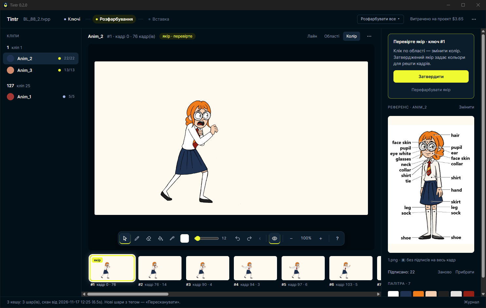

# Tintr — AI-розфарбовка ключових кадрів TVPaint

Знаходить анімаційні шари **без** тегу `_сс-` / `_cc-` у всіх кліпах відкритого проекту TVPaint (тег означає
«не фарбувати»; шари `<шар>_color`, які створює Tintr, теж пропускаються), виводить їхні ключові кадри
(instances), прибирає піксельні повтори і розфарбовує кадри методом «відро по номерах»:

- код ділить оригінальний лайн на замкнені області й нумерує їх;
- мультимодальна модель (через fal `openrouter/router/vision`) дивиться на кадр, character reference і палітру
  рефу та відповідає, яким кольором палітри залити кожну область (або «фон»);
- код заливає області пласкими кольорами рефу — без тіней, градієнтів і змін ліній;
- результат вставляється новим шаром `<шар>_color` під оригінальним шаром.



## Встановлення

1. Завантажте `Tintr.exe` з останнього релізу на сторінці **[Releases](../../releases/latest)**.
   Це один файл: встановлювати нічого не треба, Python не потрібен. Покладіть його в будь-яку папку.
2. Встановіть плагін **tvpaint-rpc.dll** у папку `plugins` TVPaint 11
   (https://github.com/brunchstudio/tvpaint-rpc/releases) і перезапустіть TVPaint.
3. Відкрийте проект у TVPaint (плагін слухає порт 3000), потім запустіть `Tintr.exe`.
4. Вкажіть fal.ai API key: меню «⋯» у правому верхньому куті → Налаштування. Ключ отримати на
   https://fal.ai/dashboard/keys; він зберігається у Windows Credential Manager, не у файлах.

**Перший запуск.** Exe не підписаний, тому Windows може показати «Windows захистив ваш ПК» —
натисніть «Докладніше» → «Виконати все одно». Деякі антивіруси хибно реагують на програми, зібрані
PyInstaller; якщо файл зник після завантаження, додайте його у виключення.

### Вимоги
- Windows 10/11 з Microsoft Edge WebView2 (у Windows 11 є за замовчуванням; для Windows 10 —
  https://developer.microsoft.com/microsoft-edge/webview2/).
- TVPaint 11 з плагіном tvpaint-rpc.
- fal.ai API key з балансом: кожен запит до моделі платний (ціни — нижче, у розділі «Моделі»).

### Оновлення
Завантажте новий `Tintr.exe` з Releases і замініть старий. Налаштування, ключ і прогрес проектів
зберігаються окремо від exe і не губляться.

## Робота
Ліворуч — кліпи і персонажі (шари без тегу `_cc-`) у них, по центру — превʼю ключа, праворуч — герой
(референс персонажа) і наступна дія для вибраного шару. Кроки вгорі: **Ключі → Розфарбування (якір, потім кадри за ним) → Вставка**.

1. **Підключитися.** Список шарів береться з кешу (`manifest.json`), без обходу всього проекту.
   Нові шари — «⋯» → «Пересканувати проект». Щоб шар не потрапляв у список, додайте до його назви тег `_cc-`. Усі кліпи паралельно — «Розфарбувати все ▾» вгорі.
2. **Вивести ключі** — один виклик TVPaint на кліп; одразу знаходяться області для розфарбування (безкоштовно).
   Ключі групуються: **Якір**, **Унікальні**, **Повтори** (повтори беруть колір оригіналу без запитів).
3. **Герой шару** — з його референсу береться палітра. Шар отримує героя з бібліотеки автоматично, якщо
   імена збігаються (шар `Ricky_1` ↔ файл `Ricky_1.png`; регістр, пробіли й дефіси не важать), інакше —
   рядок героя праворуч → вибрати зі списку. «Інший файл…» там же — окремий референс лише для цього шару.
   Підписаний референс показується праворуч, `R` — оригінал на весь кадр.
4. **Розфарбувати якір** — один запит. Інший кадр як якір: виберіть його → «⋯» біля режимів → «Зробити якорем» (або правий клік по ключу в стрічці).
5. Перевірте якір: клік по області → колір палітри або «BG — прозорий фон». **Затвердити**.
6. **Розфарбувати N кадрів** — решта унікальних ключів іде за затвердженим якорем; на кожному видно статус.
   З підписаним референсом кадр іде без зображень якоря: кольори якоря текстом («частина = колір»), частини
   нового кадру модель знаходить за підписами. На тестах це точніше (Anim 3: 91 проти 81 з 98 областей) і на
   ~20% дешевше. Без підписів — як раніше, з якорем у кадрі.
7. **Вставка** — вибрати шари і що зробити з проектом: нова версія `<проект>_tintr_vNN.tvpp`,
   перезаписати або не зберігати.

### Бібліотека героїв
Кнопка **«Герої»** вгорі (або «⋯» → «Бібліотека героїв», `Ctrl+L`) — референси всіх персонажів проекту в
одному вікні. Перетягніть туди одразу всі файли (PNG/JPG/WEBP) або «Обрати файли…»: імʼя файлу стає іменем
героя, файли копіюються в `<проект>_tintr/library/`, тож переміщення оригіналів нічого не ламає.

**«Проаналізувати всі (N)»** — модель якоря паралельно підписує частини кожного героя без підписів (по
одному запиту, ~$0.03): код ділить референс на плями кольорів, модель називає їх (hair, collar, sock…).
Підписи спільні для всіх шарів героя й повторно не оплачуються. Жовта крапка на кнопці «Герої» — є герої
без підписів. Меню «⋯» на картці: перейменувати, замінити файл (підписи скидаються, заливки шарів
перемальовуються зі збережених відповідей), проаналізувати заново, видалити (шари героя лишаться без референсу).
Файл з іменем наявного героя замінює його картинку.

Будь-який кадр можна виправити кліком по області. Змінили й заново затвердили якір — кадри, зроблені за
старим якорем, перефарбуються (повернення до вже затвердженого стану нових запитів не робить).

**Ручні правки** (режим «Колір», панель під кадром): Вибір `V` (клік по області → колір палітри),
Пензель `B`, Гумка `E` (до прозорого), Заливка `G` (область поточним кольором), Піпетка `I` / Alt+клік
(колір з кадру), розмір `[` `]`, `Ctrl+Z` / `Ctrl+Shift+Z`. Мазки жорсткі, без згладжування, лише кольорами
палітри; зберігаються окремим шаром (`paint/`) і не губляться при перефарбуванні областей чи перезаливці.
У TVPaint вставляється вже злитий результат. Ключ, змінений у TVPaint, втрачає мазки разом із кольором.

**Свій колір у палітру:** «+» у кінці палітри → «Піпетка з референса» (або `I` над референсом; клік по
референсу, Shift+клік — кілька поспіль), або будь-який колір: код `#RRGGBB` у полі чи системний вибір кольору →
«Додати» (Enter). Доданий колір іде і в ручні правки, і в палітру для моделі; права кнопка по ньому — видалити,
якщо його ніде не використано.

**Гарячі клавіші** — «?» на панелі під кадром або `H`: ←/→ ключі, `A` якір, `R` референс, `L` лайн увімк./вимк., `F`/`0` вписати,
`+`/`−` масштаб, Пробіл+тягнути — рухати кадр.

Повторний запуск продовжує з місця зупинки (`manifest.json`); вже розфарбовані кадри не оплачуються вдруге.
Змінений у TVPaint ключовий кадр розфарбовується заново. «Журнал» унизу показує час кожної фази запиту.

### Моделі
Обираються в Налаштуваннях. **Якір** — сильна модель з reasoning (за замовчуванням `anthropic/claude-opus-5.5`,
~$0.09 за якір), бо тут модель сама розбирає неоднозначні місця. **Кадри за якорем** — швидка модель без reasoning
(за замовчуванням `anthropic/claude-haiku-5.5`, ~$0.002 за кадр): зі зразком вона так само точна, але значно
швидша й дешевша. Перед запуском показується оцінка вартості; реальна ціна береться з fal.

### Де що зберігається
- Налаштування: `%APPDATA%\Tintr\config.json`; журнал витрат: `%APPDATA%\Tintr\ledger.jsonl`.
- fal.ai API key — у Windows Credential Manager (запис `Tintr-fal`).
- Прогрес і референси проекту — у папці `<проект>_tintr` поруч із файлом `.tvpp`.

## Обмеження
- Області — це замкнені зони лайну. Розриви до ~3 px закриваються автоматично; якщо дві частини з'єднані
  більшим розривом, вони стають однією областю і отримують один колір.
- Дуже дрібні області (< ~0.04 % кадру) не нумеруються й беруть колір сусідньої області.
- Плагін RPC передає кирилицю як `?`: тег `_сс-` видно як `_??-`. Tintr це враховує;
  кольоровий шар отримує латинську назву (`Anim_1_color`). Шлях до проекту бажано без кирилиці.

---

## Розробка
Потрібні Python 3.12 і [uv](https://docs.astral.sh/uv/). У PowerShell з кореня проекту:
```powershell
uv venv .venv --python 3.12
uv pip install --python .venv\Scripts\python.exe -r requirements.txt pyinstaller
.venv\Scripts\python.exe run.py                    # запуск
$env:TINTR_DEBUG = "1"; .venv\Scripts\python.exe run.py   # запуск з DevTools
.venv\Scripts\python.exe tools\probe.py            # діагностика підключення / шарів
```
Порівняти моделі на своєму затвердженому якорі: `tools\bench_vlm.py <проект.tvpp> --models … --follow <ключ>`.

### Збірка й реліз
```powershell
.venv\Scripts\pyinstaller Tintr.spec --noconfirm   # → dist\Tintr.exe
```
`build/` і `dist/` не комітяться. Готовий `dist\Tintr.exe` викладається як файл релізу на GitHub
(Releases → Draft a new release, тег на кшталт `v0.1.0`).

### Браузерний режим (дивитися з ноута, працює на компі)
```powershell
.venv\Scripts\python.exe run.py --serve              # слухає всі адреси, порт 8765
.venv\Scripts\python.exe run.py --serve --port 9000  # інший порт; --host <IP> — лише одна адреса
```
Вікна немає: у терміналі з'являються посилання з токеном (`http://<комп>:8765/?t=…`). Відкрийте будь-яке
з них у браузері на ноуті, найзручніше через адресу Tailscale (`100.x.x.x`). Токен щоразу новий; щоб
посилання не змінювалося після перезапуску, задайте свій: `$env:TINTR_TOKEN = "..."`.
- Windows Firewall має пропускати вхідні з'єднання для `.venv\Scripts\python.exe` (на запит Windows
  при першому запуску натисніть «Дозволити», або створіть правило самі).
- Референс персонажа завантажується з ноута й зберігається в `<проект>_tintr\refs`.
- З'єднання — звичайний HTTP: відкривайте лише в довіреній мережі (Tailscale, домашня LAN). Хто має
  посилання з токеном, бачить і налаштування, зокрема fal API key.

## Ліцензія
[MIT](LICENSE)
